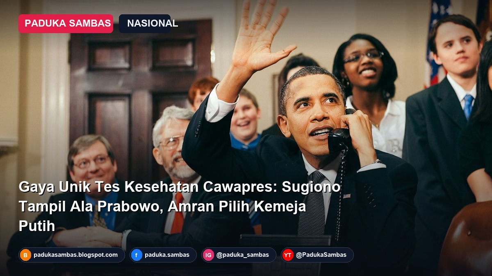

  
   <em>Ilustrasi: Gaya Unik Tes Kesehatan Cawapres: Sugiono Tampil Ala Prabowo, Amran Pilih Kemeja Putih</em>

Panggung politik nasional kembali mencuri perhatian publik dengan momen menarik dari proses pemeriksaan kesehatan calon wakil presiden. Di tengah dinamika politik yang kian memanas, penampilan para tokoh yang menjalani tes kesehatan kerap menjadi sorotan tersendiri bagi masyarakat dan awak media. Kali ini, gaya busana yang dikenakan oleh Sugiono dan Andi Amran Sulaiman saat mendatangi lokasi tes kesehatan sukses memancing komentar dan rasa penasaran publik.

## Gaya Khas dan Proses Verifikasi Ketat Menuju Pleno MPR

Proses pemeriksaan kesehatan ini merupakan bagian dari rangkaian tahapan verifikasi yang harus dilalui oleh para kandidat. Sebelum menjalani tes kesehatan fisik dan mental, kepolisian melalui Baintelkam Polri sebelumnya juga telah menerbitkan Surat Keterangan Catatan Kepolisian (SKCK) atas nama Andi Amran Sulaiman dan Sugiono sebagai salah satu syarat kelengkapan administrasi.

Yang menarik perhatian juru warta dan masyarakat di lokasi adalah pilihan busana mereka. Sugiono tampak mencuri perhatian publik dengan mengenakan pakaian bernuansa khas ala Prabowo Subianto, yang langsung menjadi bahan perbincangan hangat di media sosial. Sementara itu, Andi Amran Sulaiman tampil lebih klasik dan formal dengan kemeja putih andalannya. Hasil dari rangkaian tes kesehatan menyeluruh ini dijadwalkan akan langsung diumumkan pada sore hari dan segera dibawa ke sidang pleno MPR untuk diverifikasi lebih lanjut.

## Penentuan Dokumen Lewat Sidang Pleno Malam Hari

Setelah seluruh rangkaian tes kesehatan selesai, Tim Verifikasi MPR langsung menggelar sidang pleno pada malam harinya. Agenda utama pleno ini adalah memutuskan secara resmi apakah seluruh dokumen persyaratan, termasuk hasil pemeriksaan kesehatan dan kelengkapan administratif Andi Amran Sulaiman serta Sugiono, sudah dinyatakan memenuhi syarat atau masih memerlukan perbaikan.

Kecepatan dan transparansi dalam proses verifikasi ini menjadi kunci utama untuk menjaga kepercayaan publik terhadap integritas proses pemilihan. Masyarakat terus memantau setiap detik perkembangan dari Gedung MPR, mengingat tahapan ini sangat krusial bagi kelanjutan langkah para kandidat di kancah perpolitikan nasional.

## Menanti Keputusan Final Penyelenggara Negara

Deretan agenda maraton mulai dari penerbitan SKCK, tes kesehatan dengan gaya busana yang ikonik, hingga sidang pleno MPR menunjukkan betapa ketatnya prosedur seleksi yang harus dilalui. Publik kini tinggal menunggu keputusan final dari pihak berwenang terkait status kelayakan administratif para tokoh tersebut.

Bagaimana pendapat Anda mengenai gaya busana unik Sugiono saat tes kesehatan ini? Apakah Anda optimis proses verifikasi ini berjalan secara transparan? Sampaikan pendapat dan komentar Anda di bawah ini!

---  
*Referensi Sumber: Liputan dari berbagai media nasional terkemuka termasuk detikNews, ANTARA, dan kumparan.*

Informasi terkait dinamika dan perkembangan kebijakan publik dapat disimak lebih lanjut dalam ulasan mengenai [Tragedi Lubang Maut Pongkor: 13 Gurandil Tewas di Tambang Emas Ilegal Bogor](https://padukasambas.blogspot.com/2026/11/tragedi-lubang-maut-pongkor-13-gurandil.html).
