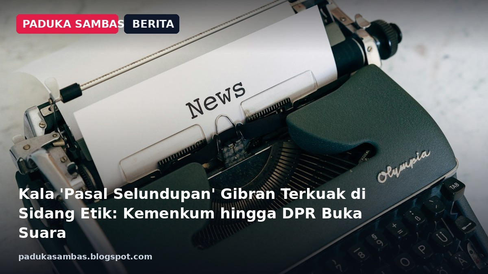

  
   <em>Ilustrasi: Kala 'Pasal Selundupan' Gibran Terkuak di Sidang Etik: Kemenkum hingga DPR Buka Suara</em>

Panggung politik nasional kembali diguncang oleh perdebatan sengit mengenai regulasi pemilu yang sarat kepentingan. Sejumlah lembaga tinggi negara, mulai dari Kementerian Hukum, Kementerian Pendidikan Dasar dan Menengah, hingga Dewan Perwakilan Rakyat (DPR), akhirnya blak-blakan memberikan kesaksian di hadapan Dewan Kehormatan Penyelenggara Pemilu (DKPP). Topik utamanya tidak lain adalah polemik yang kerap disematkan publik sebagai 'Pasal Gibran'.

Isu ini bermula dari aturan pengecualian dalam PKPU Nomor 19 Tahun 2023 yang dinilai janggal oleh berbagai kalangan. Sejumlah mantan anggota dewan bahkan mengaku baru mengetahui keberadaan aturan tersebut setelah proses persidangan di Mahkamah Konstitusi bergulir. Dinamika pengusutan pelanggaran etika penyelenggara pemilu ini tentu membawa ingatan publik pada [ujian berat mantan Kapolri Jenderal Listyo Sigit di sidang etik Polri](https://padukasambas.blogspot.com/2026/11/ujian-berat-mantan-kapolri-jenderal.html) yang juga menyita perhatian luas masyarakat beberapa waktu lalu.

## Jejak 'Pasal Pengecualian' yang Menjerat Penyelenggara

Dalam persidangan etik di DKPP, lapisan demi lapisan proses penyusunan regulasi mulai terbuka ke publik. Anggota dewan dari Komisi II sempat menyebut bahwa pihaknya merasa dikelabui terkait rumusan pasal ijazah dan syarat pendidikan dalam aturan teknis tersebut. Klausul yang mendadak muncul tanpa perdebatan panjang di ruang rapat resmi legislatif memicu kecurigaan adanya intervensi tersembunyi.

> *"Kami melihat ada prosedur yang dilompati dalam penyusunan norma turunan tersebut, yang kemudian mencederai prinsip transparansi penyelenggaraan pemilu,"* ujar salah satu pengamat hukum tata negara yang memantau jalannya persidangan.

Keberadaan pasal ini tidak hanya menjadi bahan perbincangan di ruang sidang, tetapi juga memantik perdebatan sengit di tengah masyarakat sipil. Publik mempertanyakan bagaimana sebuah aturan krusial bisa lolos tanpa pengawasan ketat dari DPR sebagai mitra kerja penyelenggara pemilu.

## Menanti Sanksi Tegas dan Kepastian Hukum

Kini, bola panas berada di tangan DKPP. Majelis etik dituntut untuk bersikap objektif dan independen dalam memutus ada atau tidaknya pelanggaran etik yang dilakukan oleh para penyelenggara pemilu. Keputusan ini diyakini akan menjadi preseden penting bagi integritas lembaga pengawas pemilu di masa depan.

Bagaimana menurut Anda? Apakah sanksi etik dari DKPP mampu mengembalikan kepercayaan publik terhadap netralitas penyelenggara pemilu di Indonesia?

Referensi: Dirangkum dari liputan berita resmi CNN Indonesia.
