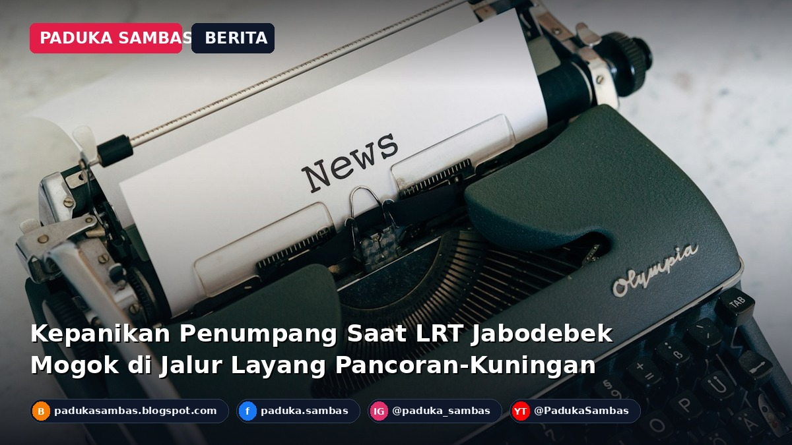

  
   <em>Ilustrasi: Kepanikan Penumpang Saat LRT Jabodebek Mogok di Jalur Layang Pancoran-Kuningan</em>

Perjalanan komuter ribuan warga ibu kota mendadak lumpuh total ketika salah satu rangkaian **LRT Jabodebek** mengalami gangguan teknis di lintas atas antara **Stasiun Pancoran** dan **Kuningan**. Insiden yang terjadi pada jam sibuk ini sontak memicu kepanikan, keluhan terbuka di media sosial, hingga kebingungan massal di dalam gerbong kereta.

Banyak penumpang yang mengira insiden tersebut diakibatkan oleh kecelakaan fatal seperti tabrakan antar-rangkaian. Namun, pihak pengelola memastikan bahwa peristiwa itu murni kendala teknis operasional yang memerlukan prosedur penanganan darurat di jalur layang.

## Kronologi Gangguan dan Kepanikan Penumpang di Dalam Gerbong

Ketegangan bermula ketika laju kereta secara tiba-tiba melambat drastis sebelum akhirnya berhenti total di tengah jalur elevated. AC sempat mati sesaat, membuat suasana di dalam kabin yang penuh sesak langsung terasa panas dan pengap.

Sejumlah penumpang yang terjebak meluapkan kekesalan mereka melalui berbagai platform digital. Mereka mengeluhkan lamanya waktu tunggu tanpa adanya informasi awal yang jelas dari petugas terkait penyebab berhentinya rangkaian.

> "Kereta berhenti cukup lama di tengah jalan tanpa ada kejelasan awal dari pengeras suara. Penumpang sempat khawatir terjadi hal-hal yang tidak diinginkan karena posisinya berada di jalur layang," ujar salah satu penumpang terdampak di lokasi.

Situasi infrastruktur transportasi publik yang kerap menghadapi kendala teknis semacam ini mengingatkan publik pada [kasus maut di tambang Pongkor](https://padukasambas.blogspot.com/2026/11/tragedi-lubang-maut-pongkor-13-gurandil.html) yang menunjukkan betapa pentingnya standar keselamatan dan mitigasi risiko yang ketat dalam setiap sektor publik.

## Klarifikasi Tegas KAI: Bukan Adu Banteng Melainkan Proses *Towing*

Menanggapi simpang siur informasi yang beredar luas di tengah masyarakat, PT Kereta Api Indonesia (Persero) atau KAI langsung memberikan klarifikasi resmi. Pihak manajemen membantah keras rumor liar yang menyebutkan telah terjadi insiden tabrakan atau 'adu banteng' antar-kereta di jalur tersebut.

Manajemen menjelaskan bahwa rangkaian yang berhenti lama itu sedang menjalani proses penarikan atau ***towing*** terhadap kereta lain yang mengalami mogok terlebih dahulu di wilayah Jakarta Selatan.

- **Penyebab Utama:** Gangguan tenaga penggerak pada salah satu unit rangkaian.
- **Tindakan Evakuasi:** Menerjunkan unit kereta penolong untuk melakukan prosedur *towing* (penarikan) menuju depo perawatan terdekat.
- **Dampak Lapas:** Penumpukan penumpang di beberapa stasiun transit akibat penyesuaian Grafik Perjalanan Kereta Api (Gapeka).

## Evaluasi Layanan dan Permintaan Maaf Terbuka

Pasca-insiden evakuasi tuntas dilakukan, operasional lintas **LRT Jabodebek** dilaporkan berangsur normal kembali menjelang sore hari. Petugas lapangan bekerja cepat menstabilkan jadwal perjalanan guna mengurai antrean panjang di peron stasiun.

Pihak manajemen KAI menyampaikan permohonan maaf secara terbuka kepada seluruh pengguna jasa atas ketidaknyamanan yang terjadi. Evaluasi menyeluruh terhadap sistem kelistrikan dan keandalan armada kini tengah digenjot agar insiden serupa tidak terulang di masa depan.

Bagaimana pengalaman Anda menggunakan transportasi publik belakangan ini? Apakah fasilitas evakuasi darurat sudah cukup memadai? Sampaikan pendapat Anda di kolom komentar.

---
*Referensi: Dirangkum dari liputan berita resmi detikNews.*
