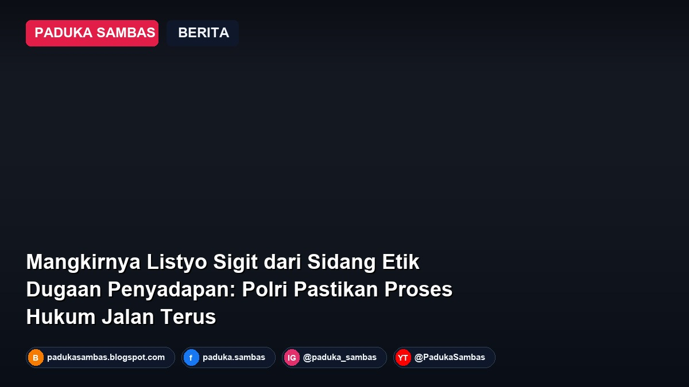

  
   <em>Ilustrasi: Mangkirnya Listyo Sigit dari Sidang Etik Dugaan Penyadapan: Polri Pastikan Proses Hukum Jalan Terus</em>

Sorotan publik kini tertuju tajam ke Markas Besar Kepolisian Republik Indonesia. Keputusan mangkir yang diambil oleh Listyo Sigit dalam agenda sidang etik terkait dugaan penyadapan dan makar memicu gelombang tanda tanya besar dari berbagai kalangan.

Langkah ini kontan mengubah dinamika internal institusi penegak hukum tersebut. Publik dibuat bertanya-tanya, apa sebenarnya pertimbangan di balik absennya figur penting ini dari ruang sidang kehormatan?

## Fakta dan Kronologi Kejadian

Agenda sidang etik yang seharusnya digelar oleh Divisi Profesi dan Pengamanan (Propam) Polri mendadak menemui jalan buntu. Ketidakhadiran pihak terlapor memaksa majelis etik menunda jalannya persidangan. Kendati demikian, otoritas kepolisian bergerak cepat meredam spekulasi liar yang beredar di tengah masyarakat.

> *"Jika yang bersangkutan kembali mangkir pada pemanggilan berikutnya, sidang etik akan tetap dilanjutkan secara in absentia demi tegaknya marwah institusi,"* tegas perwakilan resmi Divpropam Polri dalam keterangan pers terbarunya.

Fakta di lapangan mengungkap bahwa penindakan kali ini tidak pandang bulu. Siapapun yang terseret dalam pusaran isu dwi-fungsi wewenang dan dugaan pelanggaran etik harus siap menghadapi konsekuensi hukum yang berlaku tanpa terkecuali.

## Catatan Redaksi: Dampak bagi Masyarakat

Bagi masyarakat luas, transparansi dalam penegakan hukum internal kepolisian adalah harga mati. Kasus dugaan penyadapan ini bukan sekadar urusan administratif institusi, melainkan menyangkut kepercayaan publik terhadap pilar-pilar demokrasi di negeri ini.

Ketika figur-figur penting berhadap-hadapan dengan proses etik, publik menuntut ketegasan tanpa kompromi. Akuntabilitas ini menjadi cerminan apakah hukum benar-benar panglima tertinggi atau sekadar tajam ke bawah dan tumpul ke atas.

Bagaimana pandangan Anda terhadap sikap mangkir yang diambil dalam sidang etik ini? Apakah penegakan hukum internal Polri sudah cukup transparan? Sampaikan pendapat Anda di kolom komentar di bawah.

*Referensi: Dirangkum dari liputan berita resmi detikNews.*

Informasi terkait dinamika dan perkembangan kebijakan publik dapat disimak lebih lanjut dalam ulasan mengenai [Tragedi Lubang Maut Pongkor: 13 Gurandil Tewas di Tambang Emas Ilegal Bogor](https://padukasambas.blogspot.com/2026/11/tragedi-lubang-maut-pongkor-13-gurandil.html).
