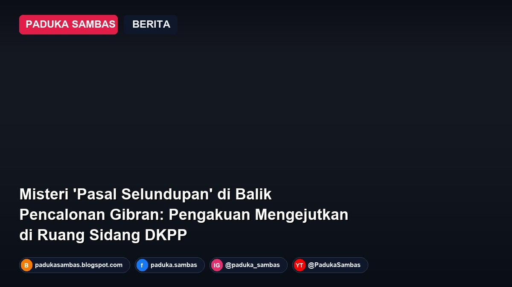

  
   <em>Ilustrasi: Misteri 'Pasal Selundupan' di Balik Pencalonan Gibran: Pengakuan Mengejutkan di Ruang Sidang DKPP</em>

Sorotan publik kini tertuju pada ruang sidang Dewan Kehormatan Penyelenggara Pemilu (DKPP). Sebuah pengakuan mengejutkan muncul ke permukaan terkait adanya dugaan 'pasal selundupan' dalam Peraturan KPU (PKPU) nomor 19 tahun 2023 yang dianggap memuluskan langkah Gibran Rakabuming Raka dalam kontestasi politik nasional.

## Fakta dan Kronologi Kejadian

Usut punya usut, benang kusut ini bermula dari proses harmonisasi aturan pencalonan. Fakta di lapangan mengungkap bahwa sejumlah pihak, termasuk mantan anggota DPR, mengaku baru menyadari keberadaan pasal pengecualian pendidikan tersebut saat proses persidangan di Mahkamah Konstitusi berlangsung. Hal ini memicu kecurigaan bahwa ada prosedur yang sengaja dilewati atau disembunyikan dari pengawasan parlemen.

Dalam sidang DKPP, perwakilan dari Kemenkumham, Kemendikdasmen, hingga DPR saling lempar klarifikasi. Ahmad Doli Kurnia, yang mewakili suara parlemen, secara gamblang menyebut pihaknya merasa dikelabui oleh pihak KPU terkait klausul ijazah yang termaktub dalam PKPU tersebut. Tak butuh waktu lama hingga isu ini menjadi bola panas yang mempertanyakan integritas penyelenggara pemilu.

> "Kami merasa tidak pernah membahas pasal pengecualian tersebut dalam rapat konsultasi, seolah-olah ada pasal yang diselundupkan begitu saja ke dalam draf final," tegas Ahmad Doli dalam keterangannya di hadapan majelis sidang.

## Catatan Redaksi: Dampak bagi Masyarakat

Mengapa isu ini krusial bagi kita? Transparansi regulasi adalah fondasi kepercayaan publik terhadap demokrasi. Ketika sebuah aturan hukum—terutama yang berkaitan dengan syarat calon pemimpin—diduga dimanipulasi melalui mekanisme 'selundupan', maka legitimasi proses politik secara keseluruhan menjadi taruhan. Masyarakat berhak mendapatkan proses yang bersih, jujur, dan taat asas tanpa ada permainan di balik meja.

Jika integritas KPU selaku penyelenggara pemilu tergerus oleh dugaan manipulasi aturan, dampak jangka panjangnya adalah erosi kepercayaan rakyat terhadap institusi negara. Ini bukan lagi sekadar debat hukum, melainkan persoalan etika bernegara yang menyentuh hak kedaulatan pemilih.

Bagaimana menurut Anda? Apakah dugaan 'pasal selundupan' ini merupakan kelalaian administratif atau kesengajaan yang terstruktur untuk kepentingan tertentu? Sampaikan pendapat kritis Anda di kolom komentar.

*Referensi: Dirangkum dari liputan berita resmi detikNews.*

Informasi terkait dinamika dan perkembangan kebijakan publik dapat disimak lebih lanjut dalam ulasan mengenai [Tragedi Lubang Maut Pongkor: 13 Gurandil Tewas di Tambang Emas Ilegal Bogor](https://padukasambas.blogspot.com/2026/11/tragedi-lubang-maut-pongkor-13-gurandil.html).
