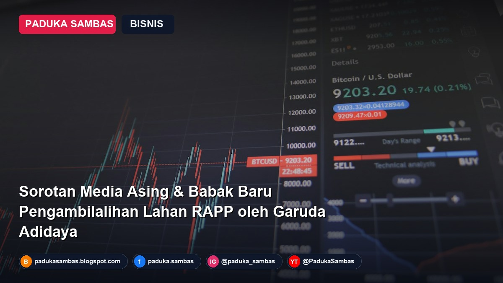

  
   <em>Ilustrasi: Sorotan Media Asing & Babak Baru Pengambilalihan Lahan RAPP oleh Garuda Adidaya</em>

Panggung bisnis dan kehutanan nasional kembali bergemuruh. Sorotan tajam kini tidak hanya datang dari dalam negeri, melainkan juga tersiar luas melalui pemberitaan media asing yang membidik langkah PT Garuda Adidaya dalam mengambil alih pengelolaan lahan yang sebelumnya dipegang oleh PT Riau Andalan Pulp and Paper (**RAPP**). 

Kebijakan strategis ini langsung memantik reaksi berantai. Mulai dari audit mendalam yang diminta oleh institusi penegak hukum hingga kekhawatiran nyata dari para pelaku usaha terhadap iklim investasi kehutanan di Indonesia.

## Perhatian Internasional dan Permintaan Audit Komprehensif

Perhatian media global terhadap dinamika korporasi di Indonesia menunjukkan bahwa isu tata kelola lahan dan industri pulp-kertas memegang peranan krusial dalam rantai pasok global. Masuknya **Garuda Adidaya** dalam pusaran pengelolaan lahan bekas konsesi raksasa tersebut dinilai sebagai titik balik signifikan.

Sebagai langkah responsif atas polemik yang bergulir, Kejaksaan Agung (**Kejagung**) tidak tinggal diam. Lembaga penegak hukum ini secara resmi meminta Badan Pengawasan Keuangan dan Pembangunan (**BPKP**) untuk melakukan audit menyeluruh terhadap aset-aset eks RAPP.

> "Pengamanan aset negara dan transparansi tata kelola perizinan masa lalu menjadi prioritas utama untuk menghindari kerugian negara sekaligus memastikan tidak ada celah hukum yang terabaikan," ujar salah satu sumber dari lembaga terkait.

Di saat bersamaan, Satuan Tugas Penertiban Kawasan Hutan (**Satgas PKH**) turut dikerahkan untuk memperkuat pengamanan fisik di lapangan. Langkah ini diambil guna mencegah potensi gesekan horizontal serta mengamankan inventaris aset yang bernilai ekonomis tinggi.

## Dilema Antara Kepastian Dunia Usaha dan Hak Ekologis

Di satu sisi, kalangan dunia usaha melontarkan alarm peringatan. Pencabutan izin konsesi secara sepihak atau mendadak dikhawatirkan dapat mengguncang kepercayaan investor global terhadap kepastian hukum di Indonesia. 

Bagi sektor swasta, stabilitas regulasi adalah fondasi utama dalam menanamkan modal jangka panjang. Perubahan pengelola seperti yang dialami Garuda Adidaya dikhawatirkan membawa efek domino terhadap rantai pasok industri kertas nasional.

Namun, di sisi lain, kelompok masyarakat sipil dan pegiat lingkungan memandang kebijakan ini dari kacamata yang sangat berbeda. Organisasi lingkungan seperti **WALHI** secara terbuka menyambut baik pencabutan izin konsesi tersebut.

* **Pemulihan Hak Rakyat:** Ruang kelola masyarakat adat dan lokal yang sempat tergerus korporasi besar didorong untuk segera dikembalikan.
* **Keadilan Ekologis:** Lahan yang dinilai rentan terhadap kerusakan lingkungan kini memiliki peluang lebih besar untuk direvitalisasi demi kepentingan jangka panjang.

Kondisi ketidakpastian ini juga memunculkan dampak sosial yang tidak kalah pelik. Nasib ribuan pekerja dan buruh yang menggantungkan hidupnya di bawah naungan ekosistem bisnis RAPP kini berada di ujung tanduk. Para pekerja menuntut kejelasan status di tengah transisi kepengurusan yang sarat gejolak ini, sebuah situasi yang mengingatkan publik pada [krisis ekonomi dan sosial akibat instabilitas sektor industri](https://padukasambas.blogspot.com/2025/03/btn-siapkan-rp-30-triliun-untuk-penuhi.html) yang pernah menuntut intervensi masif di masa lalu.

## Proyeksi Masa Depan Pengelolaan Lahan Kehutanan

Transisi penguasaan lahan dari pemain lama ke entitas baru seperti Garuda Adidaya menandai era baru pengawasan ketat terhadap korporasi kehutanan di Indonesia. Pemerintah diuji kemampuannya untuk menyeimbangkan dua kepentingan yang sering kali saling bertolak belakang: menjaga pertumbuhan ekonomi nasional dan menegakkan kedaulatan lingkungan.

Langkah BPKP dalam mengaudit aset eks RAPP akan menjadi kompas penentu. Jika transparansi dan akuntabilitas berhasil ditegakkan, maka preseden baik tercipta untuk penyelesaian konflik lahan serupa di masa depan.

Sebaliknya, jika salah dalam mengelola transisi ini, gelombang PHK massal dan penurunan kepercayaan investor bisa menjadi harga mahal yang harus dibayar oleh perekonomian nasional.

Bagaimana menurut Anda? Apakah langkah pengambilalihan dan audit ketat ini sudah tepat sasaran untuk menyelamatkan lingkungan, atau justru mengancam stabilitas ekonomi pekerja di daerah? Sampaikan pendapat Anda di kolom komentar.

*Referensi: Dirangkum dari liputan berita resmi CNBC Indonesia, Media Center Riau, Kompas.id, WALHI, dan Bisnis Indonesia e-Paper.*
