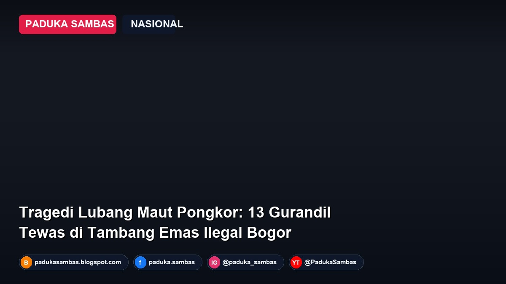

  
   <em>Ilustrasi: Tragedi Lubang Maut Pongkor: 13 Gurandil Tewas di Tambang Emas Ilegal Bogor</em>

Senyap menyelimuti kawasan tambang emas tanpa izin di kawasan Pongkor, Kabupaten Bogor. Di balik rimbunnya hutan dan terjalnya kontur bukit, dua lubang tambang ilegal mendadak menjadi saksi bisu tragedi kemanusiaan yang merenggut belasan nyawa penambang liar atau yang akrab disebut gurandil.

Operasi pencarian dan evakuasi yang digelar maraton akhirnya menemui titik akhir yang kelam. Polda Jawa Barat bersama tim gabungan harus menghadapi kenyataan pahit di lubang galian yang dipenuhi gas beracun dan risiko longsor susulan.

## Fakta dan Kronologi Kejadian

Bencana ini bermula ketika puluhan gurandil nekat menerobos masuk ke dalam perut bumi demi mendulang pundi-pundi rupiah. Usut punya usut, aktivitas di dua lubang tambang emas ilegal tersebut luput dari pengawasan ketat, meski pihak PT Antam selaku pemegang konsesi resmi mengeklaim telah menutup ribuan akses lubang serupa di kawasan yang sama.

Nahas, situasi berubah mencekam tatkala puluhan penambang terjebak di dalam lubang sempit. Sebagian dari mereka berhasil menyelamatkan diri dengan susah payah, namun nasib berkata lain bagi sebagian lainnya. Polda Jabar langsung bergerak cepat dengan mendirikan posko Disaster Victim Identification (DVI) serta menyiagakan tim medis guna mengantisipasi eskalasi korban.

Sorotan publik kian tertuju pada operasi evakuasi ini ketika Kapolda Jawa Barat secara resmi menyampaikan hasil akhir pencarian di lokasi kejadian.

> *"Sebanyak 13 penambang di Pongkor ditemukan dalam kondisi meninggal dunia setelah tim evakuasi berhasil menembus titik evakuasi yang sangat berbahaya,"* ujar pihak berwenang dalam keterangan resminya.

## Catatan Redaksi: Dampak bagi Masyarakat

Maraknya praktik pertambangan emas tanpa izin (PETI) bukan sekadar persoalan ekonomi kerakyatan, melainkan bom waktu ekologis dan keselamatan. Di satu sisi, himpitan ekonomi memaksa sebagian warga mengabaikan standar keselamatan kerja demi menyambung hidup. Namun di sisi lain, pembiaran terhadap lubang-lubang maut ini adalah ancaman nyata yang terus berulang tanpa ada efek jera yang signifikan.

Perusahaan pelat merah pemegang izin sebenarnya telah berupaya menutup ribuan akses tambang ilegal. Meski demikian, karakter medan yang luas serta tingginya tingkat desakan ekonomi membuat aktivitas penambangan liar kerap kali hidup kembali secara kucing-kucingan dengan aparat penegak hukum.

Bagaimana pandangan Anda melihat fenomena penambang liar yang terus bertaruh nyawa di tengah ancaman maut? Apakah sanksi hukum yang tegas sudah cukup, atau negara harus hadir memberikan solusi mata pencaharian alternatif yang konkret? Sampaikan pendapat Anda di kolom komentar.

*Referensi: Dirangkum dari liputan berita resmi detikNews.*

Informasi terkait dinamika dan perkembangan kebijakan publik dapat disimak lebih lanjut dalam ulasan mengenai [Tragedi Lubang Maut Pongkor: 13 Gurandil Tewas di Tambang Emas Ilegal Bogor](https://padukasambas.blogspot.com/2026/11/tragedi-lubang-maut-pongkor-13-gurandil.html).
